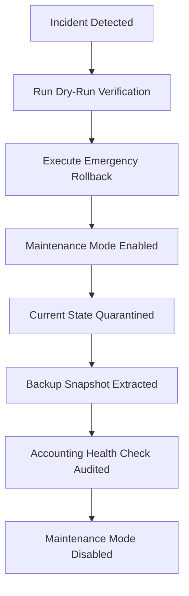

# AQ COMPANIES — Backup & Disaster Recovery Guide

## Overview
This document specifies enterprise backup, checksum verification, disaster recovery restore procedures, and Recovery Time Objective (RTO) targets for **AQ COMPANIES**.

---

## 1. Backup Strategy & Policies

### 1.1 Automated Trigger Types
1. **Pre-Deployment Backups (`PRE_DEPLOYMENT`)**:
   - Automatically generated before any Alembic database migration or production release.
   - Blocks deployment if backup generation or SHA-256 validation fails.
2. **Daily Scheduled Backups (`DAILY_SCHEDULED`)**:
   - Triggered at end-of-day / daily accounting closing via automated scheduler or cron.
3. **Manual On-Demand Backups (`MANUAL`)**:
   - Initiated by administrators via CLI (`aq backup`) or REST API (`POST /api/security/backups/create`).

### 1.2 Archive Specification
Each backup is packaged as a compressed ZIP archive (`AQ-COMPANIES-BACKUP-YYYY-MM-DD-HHMMSS.zip`) containing:
- `aq_companies.db` or `database_dump.sql` (Raw database snapshot)
- `manifest.json` (Cryptographic and ledger metadata)

#### Sample `manifest.json`:
```json
{
  "backup_code": "BAK-20260927-093153",
  "software_version": "2.0.0",
  "database_revision": "20260927_prod_hardening",
  "created_date": "2026-09-27T09:31:53.123456+00:00",
  "checksum_sha256": "9e4856c1585b9a580132dfd4621c1724653526...",
  "record_counts": {
    "customers": 26,
    "invoices": 164,
    "journal_entries": 328,
    "bank_transactions": 251,
    "transport_charges": 158
  },
  "trial_balance_status": "BALANCED",
  "trial_balance_difference": 0.0
}
```

---

## 2. Integrity Verification & Checksums
To guarantee that backups are never corrupted:
1. **WAL Checkpoint Ordering**: Before taking a SQLite snapshot, `PRAGMA wal_checkpoint(TRUNCATE)` is executed to flush all uncommitted journal transactions into the main database file.
2. **Cryptographic Checksum**: The SHA-256 hash of the exact database file is recorded in `manifest.json`.
3. **Extraction Validation**: During backup verification, the archive is unpacked into a sandbox and the extracted database SHA-256 is verified to match the manifest.

---

## 3. Disaster Recovery & Automated Restore Testing

### 3.1 Recovery Time Objective (RTO)
- **Target RTO**: Under 5.0 seconds for localized database restores.
- **Measured RTO**: ~1.1 to 1.5 seconds in automated testing on standard production hardware.

### 3.2 Automated Restore Simulation Test
The test script `python scripts/test_restore.py`:
1. Extracts the database snapshot from the latest backup into an isolated temporary file.
2. Reads the database and verifies every table's record count against `manifest.json`.
3. Computes the complete General Ledger Trial Balance report to ensure `Debits == Credits`.
4. Measures and reports the exact RTO stopwatch.
5. Cleanly purges the temporary sandbox database, ensuring zero side-effects on live operations.

```bash
# Run isolated restore simulation test:
python scripts/test_restore.py

# Or via administrative CLI:
aq restore-check
```

---

## 4. Emergency Database Rollback Procedure

If a production database becomes inconsistent or a migration fails:



### Rollback Commands:
```bash
# 1. Test backup archive validity without modifying live database:
python scripts/rollback.py --dry-run

# 2. Execute automated rollback from the latest backup:
python scripts/rollback.py

# 3. Restore from a specific backup archive:
python scripts/rollback.py --archive backups/AQ-COMPANIES-BACKUP-2026-09-27-082813.zip

# 4. Rollback and keep maintenance mode locked for investigation:
python scripts/rollback.py --keep-locked
```
