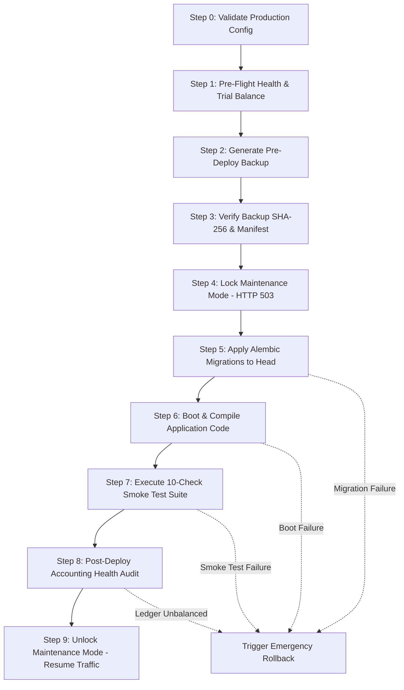

# AQ COMPANIES — Production Deployment Runbook

## Overview
This runbook defines the authoritative, accounting-safe deployment workflow for **AQ COMPANIES** (Trading • Logistics • Accounting). It covers environment isolation, deployment locking (Maintenance Mode), the automated 9-step deployment pipeline, and rollback triggers.

---

## 1. Architecture & Environment Separation
AQ Companies strictly isolates data, storage, and configurations across four standardized environments:

| Environment | Database Target | Backup Directory | Uploads Directory | Debug Mode |
| :--- | :--- | :--- | :--- | :--- |
| `development` | `sqlite:///./aq_companies.db` | `backups/` | `uploads/` | `true` |
| `testing` | `sqlite:///./aq_companies_test.db` | `backups/test/` | `uploads/test/` | `true` |
| `staging` | PostgreSQL Staging Cluster | `backups/staging/` | `uploads/staging/` | `false` |
| `production` | PostgreSQL Production Cluster | `/var/backups/aq/` | `/var/uploads/aq/` | `false` |

### Environment Configuration Rules
1. Never commit `.env` files with production secrets. Use `.env.example` as a template.
2. Production startup runs `validate_production_config(settings)` which immediately halts boot if:
   - `ENVIRONMENT == "production"` and `DEBUG == True`
   - `SECRET_KEY` is default, short (< 32 chars), or insecure
   - Database URL still points to local SQLite
   - Storage directories are unwritable or lack necessary disk quota (< 10% disk space)

---

## 2. The 9-Step Production Deployment Pipeline
Deployments must execute via `python scripts/deploy_production.py` or the GitHub Actions release workflow.



### Execution Details:
1. **Pre-Flight Health Check**: Validates that existing database Trial Balance is balanced (`Debits == Credits`, difference `$0.00`). If already corrupt, deployment refuses to start.
2. **Pre-Deploy Backup**: Invokes `python -m app.tools.pre_deploy_backup` creating a certified ZIP archive containing database snapshot and manifest.
3. **Backup Verification**: Computes SHA-256 of extracted database and matches against `manifest.json`.
4. **Maintenance Mode Lock**: Activates maintenance mode. Mutating requests (`POST`, `PUT`, `DELETE`, `PATCH`) return `HTTP 503 Service Unavailable`. Safe probes (`/health`, `/ready`, `/version`) and deployment automation carrying `X-Maintenance-Bypass` header are permitted.
5. **Database Migration**: Inspects pending migrations with `python -m app.tools.migration_check` and runs `alembic upgrade head`.
6. **Application Boot Verification**: Verifies FastAPI app initializes without syntax errors or missing dependencies.
7. **Smoke Tests**: Runs `python scripts/smoke_test.py` across 10 critical endpoints checking KPIs and ledger balances.
8. **Accounting Health Audit**: Runs `run_accounting_health_check()` verifying Trial Balance equality.
9. **Disable Maintenance Mode**: Deactivates maintenance mode, restoring normal operations.

---

## 3. Deployment Commands

### Simulation / Dry Run
```bash
# Verify all pre-flight gates without locking or modifying the database:
python scripts/deploy_production.py --dry-run
```

### Live Production Deployment
```bash
# Execute full 9-step deployment pipeline:
python scripts/deploy_production.py
```

### Standalone Health & Smoke Testing
```bash
# In-process smoke test:
python scripts/smoke_test.py

# Against a live running container or domain:
python scripts/smoke_test.py --url https://api.aqcompanies.com
```

---

## 4. Rollback Policy & Automated Failure Recovery
If any failure occurs between Step 5 and Step 8:
1. `deploy_production.py` **automatically invokes** `execute_emergency_rollback()`.
2. The failing database state is quarantined with a timestamp.
3. The verified pre-deploy backup snapshot is restored.
4. Accounting health is audited.
5. Maintenance mode remains locked if manual intervention is required.
